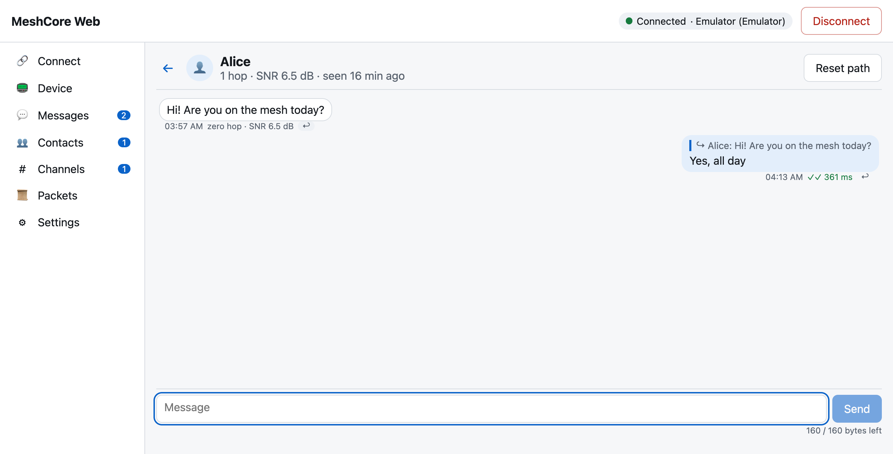
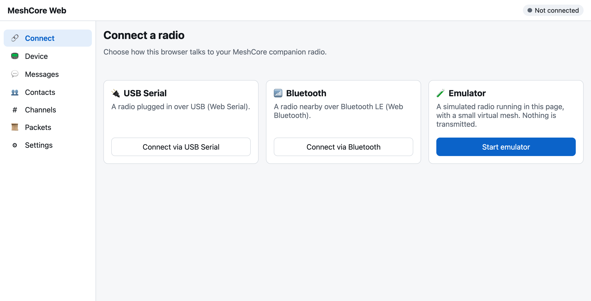
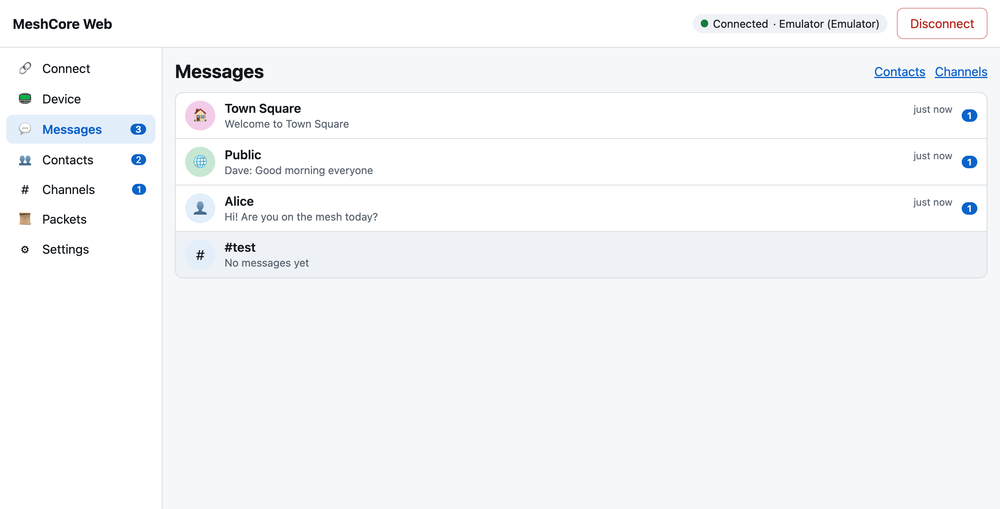
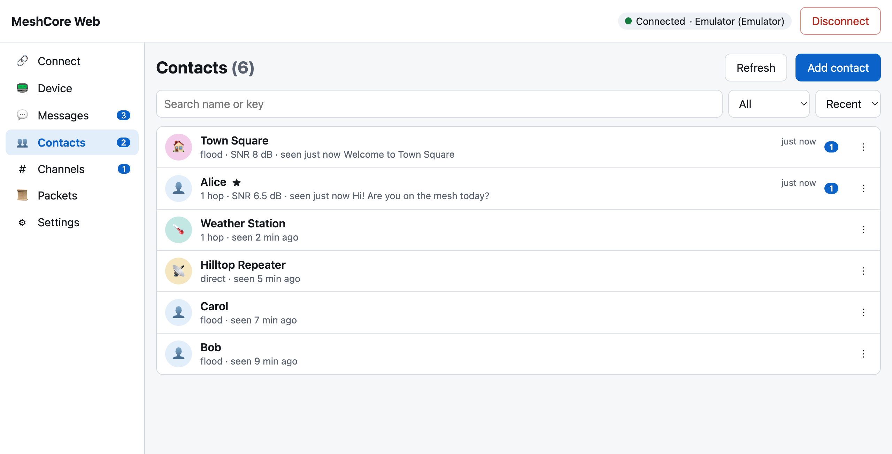
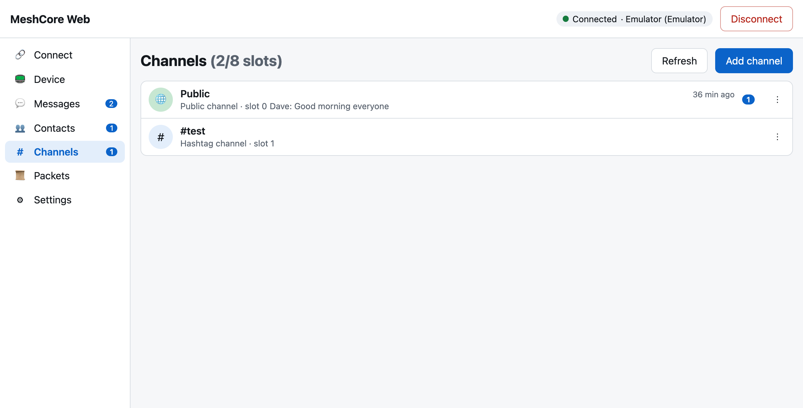
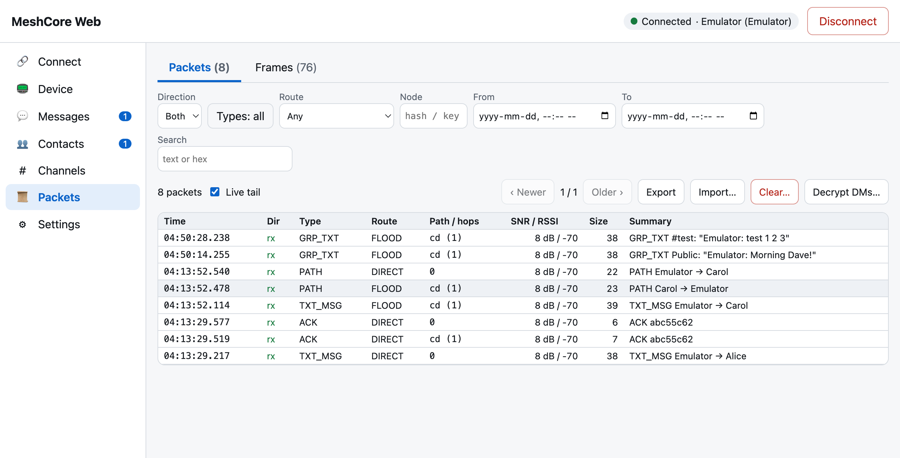
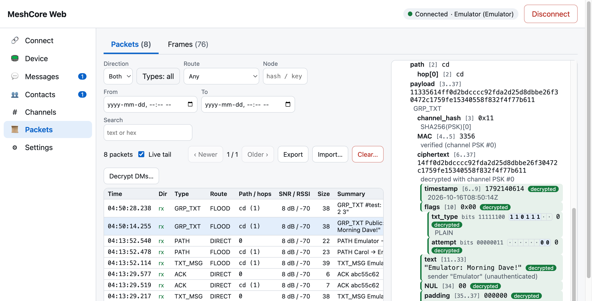
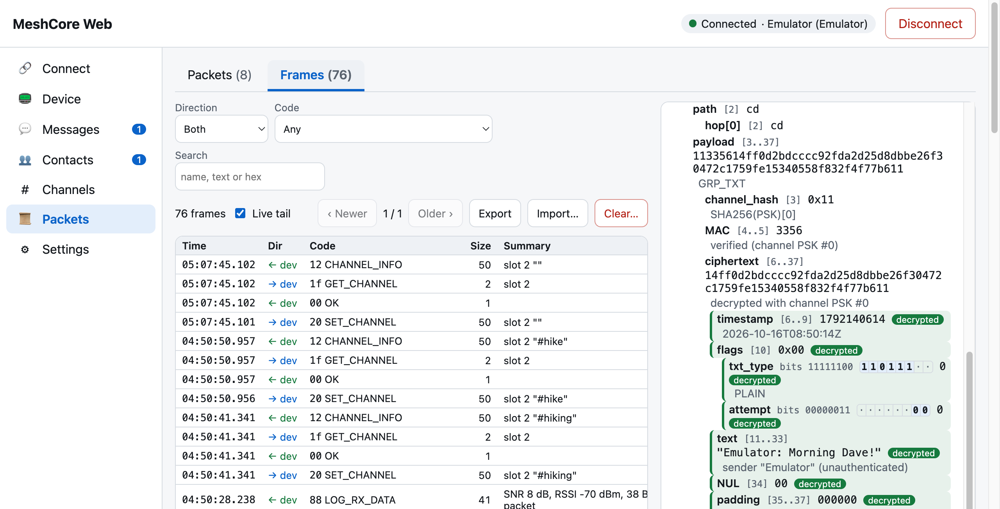
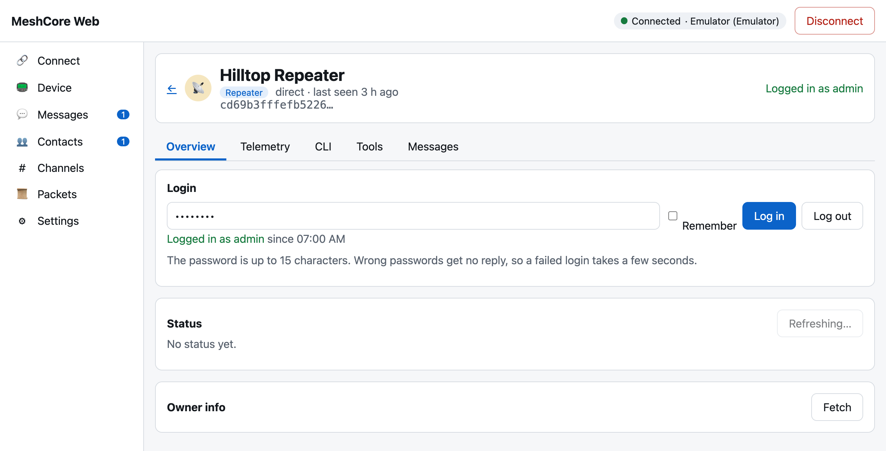

# MeshCore Web

A [MeshCore](https://meshcore.co.uk/) companion app that runs entirely in the browser.
Connect a MeshCore radio running companion firmware over **USB (Web Serial)** or
**Bluetooth LE (Web Bluetooth)** and chat, manage channels, see nodes on a map, administer
repeaters, room servers and sensors, and inspect every packet your radio hears, byte by
byte. It is a static site: no server, no account, nothing leaves your browser except what
your radio transmits (and map tiles, if you open the map).



## Features

- **Connect** over USB Serial, Bluetooth LE, or a built-in **Emulator** (a simulated radio and
  virtual mesh, so you can try everything without hardware). Previously connected radios
  are remembered; data is stored per radio.
- **Direct messages** with delivery status (pending → sent → delivered / failed), retries,
  round-trip time, replies, unread counts, UTF-8 aware byte counter.
- **Contacts**: type, last heard, route and SNR; search, filter, sort; add from
  `meshcore://` links or public keys; share, reset path, remove.
- **Channels**: Public, private (PSK) and `#hashtag` channels; add, edit, mute, delete.
- **Map** of nodes that advertise a location, with distance and bearing from your radio;
  OpenStreetMap tiles by default, configurable tile server.
- **Packet log and inspector**: every over-the-air packet and every host↔radio frame is
  recorded; an annotated hex dump explains each byte; channel messages are decrypted, and
  direct messages too if you opt in to storing the radio's key. Export / import as JSON.
- **Repeater / room server / sensor admin**: login, status, telemetry (Cayenne LPP),
  firmware CLI with autocomplete, trace path, path discovery, neighbours, ACL, room posts.
- **Device settings**: name, location, radio parameters with regional presets, TX power,
  adverts, time sync, stats, BLE PIN, contact policy, tuning, key export/import, reboot,
  factory reset.
- **Installable PWA** that opens offline; light/dark theme; keyboard accessible; works on
  narrow screens.

| | |
|---|---|
|  |  |
|  |  |
|  |  |
|  |  |

**Browser support:** Chrome / Edge (desktop; Android for Bluetooth). Firefox and Safari lack
Web Serial and Web Bluetooth (the Emulator still works there). The page must be served over
HTTPS or from `localhost`.

See the **[user guide](docs/user-guide.md)** for connecting (including permission prompts
and Linux udev/dialout setup), every feature, PWA install and troubleshooting.

## Quick start

Requires Node.js 22+.

```sh
npm install
npx playwright install chromium   # once, for the browser tests
npm run dev                       # http://localhost:5180
```

Open http://localhost:5180 in Chrome and click **Start emulator** — or plug in a radio and
click **Connect via USB Serial**.

To deploy, run `npm run build` and host `packages/web/dist/` on any static HTTPS host. The
build uses relative paths (`base: './'`), so it works from any sub-path.

## Scripts (run from the repo root)

| Script              | What it does                                                    |
| ------------------- | --------------------------------------------------------------- |
| `npm install`       | Install all workspaces                                          |
| `npm run dev`       | Vite dev server for the web app on http://localhost:5180        |
| `npm test`          | core tests (Node) then web tests (headless Chromium)            |
| `npm run typecheck` | `tsc --noEmit` for both packages                                |
| `npm run lint`      | Alias for `typecheck` (no eslint/prettier by design)            |
| `npm run build`     | core → `packages/core/dist`, web → `packages/web/dist`          |

Per package: `npm test -w packages/core`, `npm test -w packages/web`,
`npm run preview -w packages/web` (serves the production build, with the service worker, on
port 4173). `node packages/web/scripts/render-icons.mjs` re-renders the PNG app icons from
`packages/web/public/icon.svg`.

## Architecture

```
packages/
  core/   @meshcore-web/core — pure TypeScript, no DOM, ESM, strict
          util/       bytes, hex, crc, events
          protocol/   companion protocol encoders/decoders (typed frames)
          framing/    serial framing; transport/ Web Serial, Web Bluetooth, loopback
          client/     CompanionClient: handshake, sync, send/ack, remote requests
          packet/     mesh packet parser, crypto, byte annotator for the inspector
          emulator/   CompanionEmulator + VirtualMesh (real packets, real crypto)
          store/      IndexedDB repositories (frames, packets, messages, contacts, …)
          app/        framework-agnostic app models (signals) the UI binds to
  web/    @meshcore-web/web — Vite + Lit: thin components rendering app-model state
          src/pages/  connect, device, messaging, map, packets, admin, settings
          public/     manifest, service worker, icons
```

The UI is deliberately thin: logic lives in `packages/core/src/app` models (see
[`packages/core/src/app/README.md`](packages/core/src/app/README.md)). The only runtime
dependency is [`lit`](https://lit.dev/).

Further reading in [`docs/`](docs/):

- [`roadmap.md`](docs/roadmap.md) — goals, architecture, phases and design decisions
- [`companion-protocol.md`](docs/companion-protocol.md) — the host↔radio protocol
- [`mesh-packet-format.md`](docs/mesh-packet-format.md) — over-the-air packet format
- [`feature-inventory.md`](docs/feature-inventory.md) — features of the official apps
- [`user-guide.md`](docs/user-guide.md) — end-user documentation

The protocol docs are derived from MeshCore firmware `companion-v1.18.0`; the firmware
source is the final authority.

## Testing

Everything is tested against a faithful emulator instead of real hardware:

- **core** (vitest in Node): byte-exact tests for every protocol encoder/decoder with the
  layout cited from the docs; packet parser and crypto; `CompanionEmulator` mirrors the
  firmware's companion behaviour and `VirtualMesh` runs chat/repeater/room/sensor nodes that
  exchange real MeshCore packets with real Ed25519/X25519/AES/HMAC crypto on a deterministic
  clock; `CompanionClient` and the app models are tested end-to-end against it;
  `fake-indexeddb` for storage.
- **web** (vitest browser mode, headless Chromium via Playwright): the real app is mounted
  and driven through mocked `navigator.serial` / `navigator.bluetooth` that route frames to
  an in-process emulator, so UI tests exercise the real Web Serial / Web Bluetooth
  transports, client, store and models end to end.

Real-hardware behaviour (especially BLE quirks) is verified manually; reports welcome.

## Contributing

Contributions are welcome. Please:

- read [`CLAUDE.md`](CLAUDE.md) (working conventions) and [`docs/roadmap.md`](docs/roadmap.md);
- keep `core` free of DOM access (inject browser objects through factories) and keep UI
  logic in `packages/core/src/app` models;
- add tests with every change (byte-exact tests for protocol code, a browser test for UI);
- avoid new dependencies (runtime is `lit` only — discuss before adding anything);
- run `npm run typecheck && npm test && npm run build` before opening a pull request;
- if you find a protocol doc error, fix the doc in the same change.

## Acknowledgements

A big thank you to the developers of [MeshCore Open](https://github.com/zjs81/meshcore-open),
the open-source Flutter companion app. Much of this project's feature set mirrors theirs, and
their implementation was the reference for interoperable behaviour such as SMAZ message
compression, reactions and path handling.

## Licence

[MIT](LICENSE) © MeshCore Web contributors.

MeshCore Web is an independent project and is not affiliated with the MeshCore project.
Thanks to the [MeshCore](https://github.com/meshcore-dev/MeshCore) firmware authors and
community for the protocol and firmware this app builds on. Map data
© [OpenStreetMap](https://www.openstreetmap.org/copyright) contributors.
